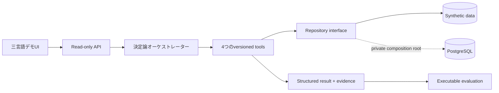

# Haruka CRM Intelligence

**日本語** · [简体中文](README.zh-CN.md) · [English](README.md)

> 顧客・購買データから、決定論的ツールで根拠を確認できるリテンション・CRM施策を導く意思決定支援デモです。

[デモ / ローカル実行](docs/deployment.md#live-demo) · [アーキテクチャ](docs/architecture.md) · [評価](docs/evaluation.md)

合成データ、型付きツール、計算指標、根拠、実行履歴、評価を一つの流れで確認できます。**この例を試す · CUST-002**を選び、分析を実行してください。自動実行はしません。English / 日本語 / 简体中文に対応しています。

## 解決する課題

顧客、取引、商品、施策のデータがあっても、CRM担当者が次の判断を迅速に行うことは容易ではありません。

- 高価値顧客は誰か
- 離反リスクを示す測定可能なシグナルは何か
- 次に検証すべき施策仮説は何か
- 推奨を支える事実とルールは何か

HARUKAは、元データから根拠付きの意思決定出力までを一つの流れとしてモデル化します。一般的なダッシュボードを装飾するのではなく、業務課題、データモデル、ツール境界、透明な計算、評価を示します。

## 実装状況

| 機能 | 状況 | 内容 |
|---|---|---|
| 合成データのブラウザデモ | **実装済み** | UI、API、オーケストレーション、ツール、根拠、評価がローカルで動作します。 |
| 決定論的な指標・推奨 | **実装済み** | TypeScriptの明示的な式・ルールとテストがあります。 |
| PostgreSQL schema | **再現可能な参照実装** | DDL、制約、index、RLS有効化を含みます。 |
| PostgreSQL repository adapter | **実装済み・公開ランタイム未接続** | SQL clientを注入し、parameterized queryを使用します。driverや認証情報は含みません。 |
| LLM推論 | **未実装** | 将来の説明レイヤー候補ですが、決定論計算を置き換えません。 |
| 本番認証・書き込みAPI・private infrastructure | **意図的に除外** | 公開ポートフォリオの境界外です。 |

## アーキテクチャ



ブラウザデモは実線の経路です。点線は、本番接続を公開せずに実際のadapter境界を示します。詳細は [architecture.md](docs/architecture.md) を参照してください。

## Agent tools

| Tool | 入力 | 出力 | 責務 |
|---|---|---|---|
| `query_customer` | `customerId`, `asOfDate` | 顧客、注文、明細、購入済み商品role | 後続処理に必要な事実だけを取得します。 |
| `calculate_ltv` | `customerId`, `asOfDate` | 売上、AOV、頻度、recency、coupon率、推定LTV | 数値計算を決定論的・検証可能に保ちます。 |
| `find_churn_risk` | `asOfDate`, 任意の`customerId` | risk分類と閾値 | 全顧客に同じ明示的ルールを適用します。 |
| `recommend_campaign` | 顧客事実、指標、商品role | action、priority、channel、KPI、説明、guardrail | 自動意思決定ではなく、検証可能な施策仮説を作ります。 |

## ワークフロー例

合成顧客 `CUST-002` について「CRM施策を推奨してください」と質問すると、以下を順番に実行します。

```text
query_customer       → 注文1件、最終購買 2025-12-01
calculate_ltv        → 観測売上 4,000円、推定LTV 4,800円
find_churn_risk      → 303日経過、120日ルールで high risk
recommend_campaign  → personalized_win_back / high priority
```

出力には三言語summary、structured result、source-linked evidence、判断理由、制約、tool traceが含まれます。

## 計算と評価

- 注文純売上 = `数量 × 単価` の合計 × `(1 − 割引率)`
- AOV = 観測純売上 ÷ 注文件数
- 推定LTV = 観測売上 × 頻度倍率（`1.2`、`2.0`、`2.8`）
- 離反リスク = 60日未満 low、60日以上 medium、120日以上または購買なし high

これは本番予測ではなく、説明可能な計画用ヒューリスティックです。[`examples/`](examples/) の5シナリオがintent、tool順序、confidence、期待値、根拠typeを実行時に検証します。詳細は [evaluation.md](docs/evaluation.md) を参照してください。

## データモデル

`Customer 1—N Order`、`Order 1—N OrderItem`、`Product 1—N OrderItem`、`Campaign 0—N Order` です。外部キー、非負制約、期間制約、RLS有効化を [sanitized migration](database/migrations/0001_public_demo.sql) に含めています。詳細は [data-model.md](docs/data-model.md) を参照してください。

## ローカル実行

Node.js 22.13以上が必要です。

```bash
npm ci --ignore-scripts
npm run dev
```

`http://127.0.0.1:3000` を開きます。DBも環境ファイルも不要で、`synthetic` modeで起動します。[安全な公開手順](docs/deployment.md#日本語)を参照してください。

```bash
npm run secret:scan
npm run audit:deps
npm run typecheck
npm run lint
npm test
npm run eval
npm run build
npm run links:check
```

## 本番版と公開デモの境界

> This repository is a sanitized portfolio edition. Production infrastructure, credentials, private operational configuration, and non-public product logic are intentionally excluded.

private製品と公開版は、別のrepository・別のhistoryです。Supabase URL、service role、DB password、user email、実顧客データ、production analytics、deployment metadata、管理route、private prompt、logは含みません。公開APIにwrite/import/reset/admin endpointはありません。

設計上の判断は、(1) 決定論計算と文章生成を分離、(2) evidenceをfirst-class output化、(3) structured tool contract、(4) UIと独立したevaluation、(5) synthetic/production boundaryの固定、の5点です。

公開runtimeはread-only / in-memoryで、推奨は因果効果ではなく検証仮説です。LLM推論、RAG、MCP、自律実行、因果uplift modeling、外部配信は未実装です。決定論オーケストレーターであり、LLM Agentではありません。入力はアプリに保存されませんが、ホスティング事業者がアクセス情報を保持する可能性があります。架空の質問だけを使用してください。[SECURITY.md](SECURITY.md)も参照してください。

## License

[MIT](LICENSE)
