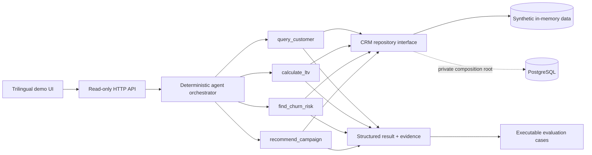
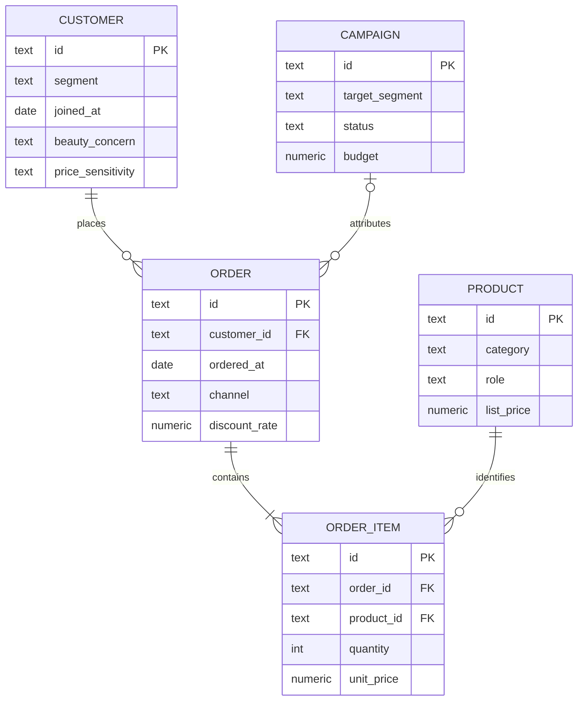

# Haruka CRM Intelligence

[日本語](README.ja.md) · [简体中文](README.zh-CN.md) · **English**

> Explainable CRM decision support: deterministic tools turn customer and transaction data into reviewable retention and campaign recommendations.

[Live demo / run locally](docs/deployment.md#live-demo) · [Architecture](#architecture) · [Evaluation](#evaluation)

Explore a complete customer-to-decision workflow: typed tools, exact calculations, source-linked evidence, and executable evaluations. English / 日本語 / 简体中文. Select **Try this example · CUST-002**, then run the analysis; it never runs automatically.

## Why this exists

CRM teams often have customer, transaction, product, and campaign data but still struggle to answer four operational questions quickly:

- Which customers are high value?
- Which customers show a measurable churn-risk signal?
- Which campaign hypothesis should be tested next?
- Which facts and rules support that recommendation?

Haruka models that decision path from source records to an evidence-backed output. It is designed to show business problem framing, data modeling, tool boundaries, transparent calculations, and evaluation—not to imitate a production CRM with decorative screens.

## What it demonstrates

- domain modeling for customers, products, orders, order items, and campaigns;
- customer-level revenue, purchase frequency, recency, and heuristic LTV calculations;
- a repository boundary with synthetic and parameterized PostgreSQL implementations;
- a deterministic agent orchestrator with four versioned tools;
- structured results with evidence IDs, source entities, caveats, and a visible tool trace;
- multilingual presentation in English, Japanese, and Simplified Chinese;
- executable evaluation scenarios for calculations, tool selection, invalid input, insufficient evidence, and recommendation consistency.

## Implementation status

| Capability | Status | What that means |
|---|---|---|
| Synthetic browser demo | **Implemented** | UI, API, orchestration, tools, evidence, and evaluation run locally. |
| Deterministic metrics and recommendations | **Implemented** | Formulas and rules are explicit TypeScript code with tests. |
| PostgreSQL schema | **Implemented as a reproducible reference** | Normalized DDL, constraints, indexes, and RLS enablement are included. |
| PostgreSQL repository adapter | **Implemented, not wired into the public runtime** | It accepts an injected SQL client and uses parameterized queries; no driver or credentials are bundled. |
| LLM inference, RAG, MCP, autonomous execution | **Not implemented** | This is a deterministic tool orchestrator, not an LLM agent. |
| Production auth, write APIs, and private infrastructure | **Intentionally excluded** | These stay outside the public portfolio boundary. |
| Predictive churn or uplift model | **Planned research direction, not implemented** | Current churn and campaign outputs are reviewable rules, not ML predictions. |

## Architecture



The browser demo follows the solid path. The dotted PostgreSQL path documents a real adapter boundary without publishing a production connection or pretending that the public runtime uses one. See [architecture details](docs/architecture.md).

## Agent tools

The “agent” in this edition is a deterministic orchestrator. Its route selection and tool sequence are visible in `src/agent/orchestrator.ts`; it does not expose or claim hidden chain-of-thought.

| Tool | Input | Output | Responsibility |
|---|---|---|---|
| `query_customer` | `customerId`, `asOfDate` | customer facts, eligible orders, order items, purchased product roles | Retrieve only the facts required by downstream tools. |
| `calculate_ltv` | `customerId`, `asOfDate` | revenue, AOV, order count, recency, coupon rate, heuristic LTV | Keep numeric business calculations deterministic and testable. |
| `find_churn_risk` | `asOfDate`, optional `customerId` | ranked customer risk results and explicit thresholds | Classify recency risk with the same reviewable rule for every customer. |
| `recommend_campaign` | customer facts, metrics, purchased roles | one action code, objective, priority, channel, KPI, explanation, guardrail | Turn evidence into a campaign hypothesis—not an automated customer decision. |

## Example workflow

All entities below are fictional.

```text
User question
  “Recommend a campaign action for CUST-002.”

Tool calls
  query_customer
    → 1 order; last purchase 2025-12-01
  calculate_ltv
    → observed revenue JPY 4,000; estimated LTV JPY 4,800
  find_churn_risk
    → 303 days since purchase; high risk under the 120-day rule
  recommend_campaign
    → personalized_win_back; priority high; KPI reactivation_rate

Supporting evidence
  customer and order IDs + deterministic rule IDs

Guardrail
  use a holdout group and cap contact frequency before interpreting lift
```

The response includes localized summaries, a structured result, source-linked evidence, decision rationale, limitations, and the exact tool sequence.

## Calculation logic

- Net order revenue = `sum(quantity × unit price) × (1 − discount rate)`.
- Average order value = observed net revenue / observed orders.
- Heuristic LTV = observed revenue × frequency multiplier (`1.2`, `2.0`, or `2.8`).
- Churn risk = low before 60 days, medium from 60 days, high from 120 days or when no purchase exists.

These values support portfolio discussion and deterministic testing. They are not calibrated forecasts. The output states that margin, acquisition cost, returns, survival modeling, and causal lift are excluded.

## Evaluation

Five executable scenarios live in [`examples/`](examples/):

1. customer profile with purchase evidence;
2. exact high-value LTV calculation;
3. dormant-customer churn classification;
4. traceable win-back recommendation;
5. limited onboarding recommendation when purchase evidence is absent.

`npm run eval` executes each case and checks the selected intent, ordered tool calls, confidence, expected structured values, and evidence types. Unit tests separately check formula boundaries, API validation, parameterized repository behavior, and the complete recommendation pipeline. See the [evaluation design](docs/evaluation.md).

## Data model



The customer grain is one row per synthetic customer; the order-item grain is one product line per order. Foreign keys and check constraints prevent orphan references and negative quantities or prices. Full rationale is in [data-model.md](docs/data-model.md).

## Repository structure

```text
public/                         trilingual browser demo
src/
  agent/                       orchestrator and four tools
  analytics/                   deterministic metrics
  api/                         read-only API handler
  data/                        generated synthetic dataset
  domain/                      entities, localized evidence, validation
  evaluation/                  executable evaluation contract
  repositories/               interface, in-memory and PostgreSQL adapters
database/
  migrations/                  sanitized PostgreSQL DDL
  seed/                        fictional SQL seed
examples/                      five runnable CRM scenarios
tests/                         metric, API, orchestration, repository, eval tests
docs/                          architecture, data model, evaluation
scripts/                       eval, secret scan, and link checks
```

## Run locally

Requirements: Node.js 22.13 or newer.

```bash
npm ci --ignore-scripts
npm run dev
```

Open `http://127.0.0.1:3000`. No environment file or database is required. `.env.example` lists optional, public-safe configuration only; the server does not automatically load `.env` files. See [safe public deployment](docs/deployment.md).

Quality checks:

```bash
npm run secret:scan
npm run audit:deps
npm run typecheck
npm run lint
npm test
npm run eval
npm run build
npm run build:vercel
npm run test:deployment
npm run links:check
```

### Public API

- `GET /api/health` — dataset mode, as-of date, and record counts;
- `GET /api/customers` — synthetic customer list;
- `POST /api/agent/run` — validated question and optional customer ID to structured result.

There are deliberately no public write, import, reset, credential, or administration endpoints.

## Production vs public demo

> This repository is a sanitized portfolio edition. Production infrastructure, credentials, private operational configuration, and non-public product logic are intentionally excluded.

The private product and this public edition are separate repositories with separate histories. This edition does not include a Supabase project URL, service role, database password, user email, real customer data, production analytics, deployment metadata, internal administration routes, private prompts, or private logs.

The export decision record is summarized in [docs/sanitization.md](docs/sanitization.md).

The PostgreSQL adapter demonstrates the seam used by a private composition root. Enabling it safely would require an injected driver, server-side credentials, authentication and authorization, least-privilege roles, narrowly scoped RLS policies, audit logging, and deployment-specific threat review.

## Design decisions

1. **Separate calculation from language generation.** Revenue, LTV, recency, and recommendation rules stay deterministic. A future LLM may explain those outputs but must not invent or silently recalculate them.
2. **Make evidence a first-class output.** Evidence IDs point to source entity IDs or rule IDs, so reviewers can inspect why a result exists.
3. **Use structured tool outputs.** Stable contracts make the same capability callable by the UI, tests, an API, or a future private agent service.
4. **Keep evaluation independent from presentation.** JSON scenarios exercise orchestration and business outcomes without relying on screenshots or UI snapshots.
5. **Enforce the synthetic/production boundary.** The default repository contains generated records with no emails. Production connections and operational history are not part of the public artifact.

## Limitations

- The public runtime is read-only and in-memory; it resets when the process restarts.
- Campaign recommendations are deterministic hypotheses, not causal estimates or autonomous decisions.
- Churn thresholds and LTV multipliers are intentionally simple and require business calibration.
- The PostgreSQL adapter is tested with an injected SQL-client contract, not against a hosted database in this public repository.
- No LLM inference, RAG, MCP, autonomous execution, causal uplift modeling, or external customer messaging is implemented here.
- The application does not persist inputs or track visitors; a hosting provider may retain access metadata. Use fictional questions only. Public hosting requires platform rate/cost controls.

## Security

Read [SECURITY.md](SECURITY.md) before adapting the project. Never place production credentials or customer data in this repository.

## License

[MIT](LICENSE)
