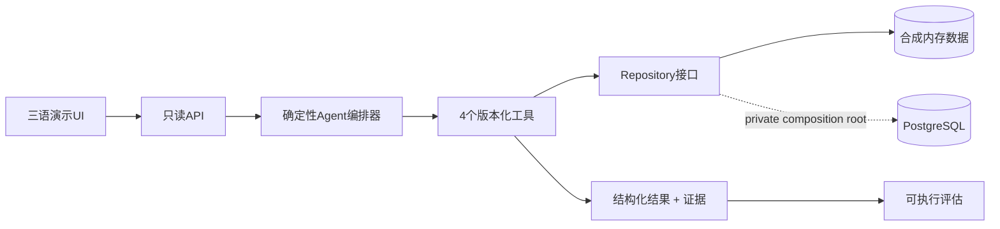

# Haruka CRM Intelligence

[日本語](README.ja.md) · **简体中文** · [English](README.md)

> 一个可解释的 CRM 决策支持演示，通过确定性工具把客户与交易数据转化为可审查的留存和营销建议。

[演示 / 本地运行](docs/deployment.md#live-demo) · [架构](docs/architecture.md) · [评估](docs/evaluation.md)

从合成客户出发，检查类型化工具、计算指标、推荐证据、调用轨迹与可执行评估。选择**试试这个示例 · CUST-002**后点击运行；不会自动执行。支持 English / 日本語 / 简体中文。

## 要解决的问题

即使企业已经拥有客户、交易、产品和营销活动数据，CRM 团队仍然很难快速判断：

- 哪些客户具有高价值；
- 哪些客户存在可衡量的流失风险信号；
- 下一步应该测试什么营销假设；
- 建议背后有哪些事实和规则证据。

HARUKA 把源记录到证据型决策结果建模为完整链路。重点不是堆叠普通仪表盘，而是证明业务问题建模、数据建模、工具边界、透明计算和独立评估能力。

## 实现状态

| 能力 | 状态 | 说明 |
|---|---|---|
| 合成数据浏览器演示 | **已实现** | UI、API、编排器、工具、证据和评估均可在本地运行。 |
| 确定性指标与建议 | **已实现** | 公式和规则是有测试的显式 TypeScript 代码。 |
| PostgreSQL schema | **可复现参考实现** | 包含 DDL、约束、索引与 RLS 启用。 |
| PostgreSQL repository adapter | **已实现，但未接入公开运行时** | 接收注入的 SQL client，并使用参数化查询；不附带 driver 或凭据。 |
| LLM 推理 | **未实现** | 将来可作为解释层，但不能替代确定性计算。 |
| 生产认证、写入 API、私有基础设施 | **有意排除** | 不属于公开作品集边界。 |

## 架构



浏览器演示运行实线路径。虚线展示真实 adapter 边界，但不会公开或伪装生产数据库连接。详见 [architecture.md](docs/architecture.md)。

## Agent tools

| 工具 | 输入 | 输出 | 职责 |
|---|---|---|---|
| `query_customer` | `customerId`, `asOfDate` | 客户、订单、明细、已购产品角色 | 只检索后续工具需要的事实。 |
| `calculate_ltv` | `customerId`, `asOfDate` | 销售额、AOV、频次、最近购买、优惠券比例、估算LTV | 保持数值计算确定、透明、可测试。 |
| `find_churn_risk` | `asOfDate`、可选`customerId` | 风险分类与明确阈值 | 对所有客户应用同一套可审查规则。 |
| `recommend_campaign` | 客户事实、指标、产品角色 | 行动、目标、优先级、渠道、KPI、说明、护栏 | 生成可测试营销假设，而不是自动替客户做决定。 |

## 示例工作流

对合成客户 `CUST-002` 提问“推荐一项营销行动”时：

```text
query_customer       → 1 笔订单；上次购买 2025-12-01
calculate_ltv        → 观测销售额 4,000 日元；估算 LTV 4,800 日元
find_churn_risk      → 已过 303 天；按 120 天规则判为 high risk
recommend_campaign  → personalized_win_back / high priority
```

响应包含三语摘要、结构化结果、可追溯证据、决策理由、限制以及准确的工具调用顺序。

## 计算与评估

- 订单净销售额 = `数量 × 单价` 之和 × `(1 − 折扣率)`；
- AOV = 观测净销售额 ÷ 订单数；
- 估算 LTV = 观测销售额 × 频次乘数（`1.2`、`2.0` 或 `2.8`）；
- 流失风险 = 60 天前为 low、60 天起为 medium、120 天起或无购买记录为 high。

这些是可解释的规划启发式规则，不是校准后的生产预测。[`examples/`](examples/) 中的 5 个场景会真正执行并检查意图、工具顺序、置信度、预期结构化值和证据类型。详见 [evaluation.md](docs/evaluation.md)。

## 数据模型

关系为 `Customer 1—N Order`、`Order 1—N OrderItem`、`Product 1—N OrderItem`、`Campaign 0—N Order`。脱敏的 [PostgreSQL migration](database/migrations/0001_public_demo.sql) 包含外键、非负约束、日期约束、索引和 RLS 启用。详见 [data-model.md](docs/data-model.md)。

## 本地运行

需要 Node.js 22.13 或更高版本。

```bash
npm ci --ignore-scripts
npm run dev
```

打开 `http://127.0.0.1:3000`。无需环境文件或数据库，默认以 `synthetic` 模式运行。参见[安全公开部署](docs/deployment.md#简体中文)。

```bash
npm run secret:scan
npm run audit:deps
npm run typecheck
npm run lint
npm test
npm run eval
npm run build
npm run links:check
```

## 生产版本与公开演示边界

> This repository is a sanitized portfolio edition. Production infrastructure, credentials, private operational configuration, and non-public product logic are intentionally excluded.

私有产品与公开版本是两个独立仓库、两套独立历史。本仓库不包含 Supabase URL、service role、数据库密码、用户邮箱、真实客户数据、生产 analytics、deployment metadata、内部管理路由、私有 prompt 或日志。公开 API 也没有 write/import/reset/admin endpoint。

关键设计判断包括：(1) 确定性计算与语言生成分离；(2) 证据是一等输出；(3) 使用结构化工具 contract；(4) 评估独立于 UI；(5) 固定 synthetic/production 数据边界。

当前限制：公开运行时只读且在内存中；活动建议是可测试假设而非因果增量结论。LLM 推理、RAG、MCP、自主执行、因果 uplift 建模及外部客户触达均未实现；这是确定性工具编排器，不是 LLM Agent。应用不保存输入，但托管平台可能保留访问元数据，请仅输入虚构问题。安全说明见 [SECURITY.md](SECURITY.md)。

## License

[MIT](LICENSE)
