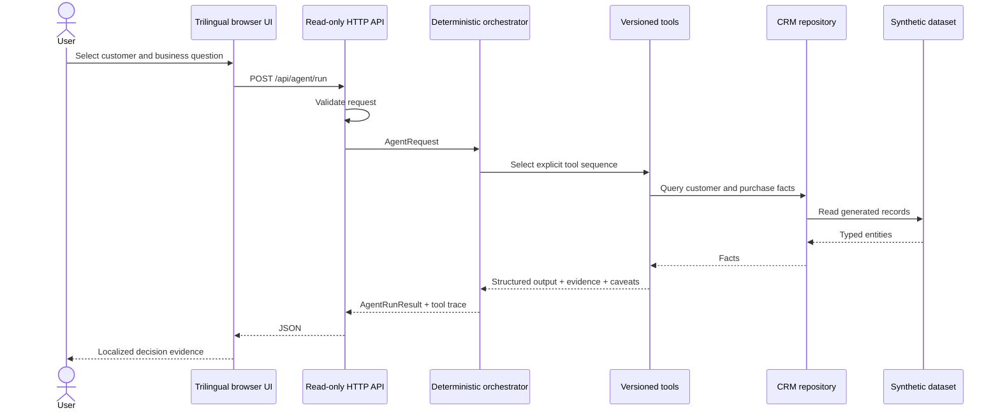
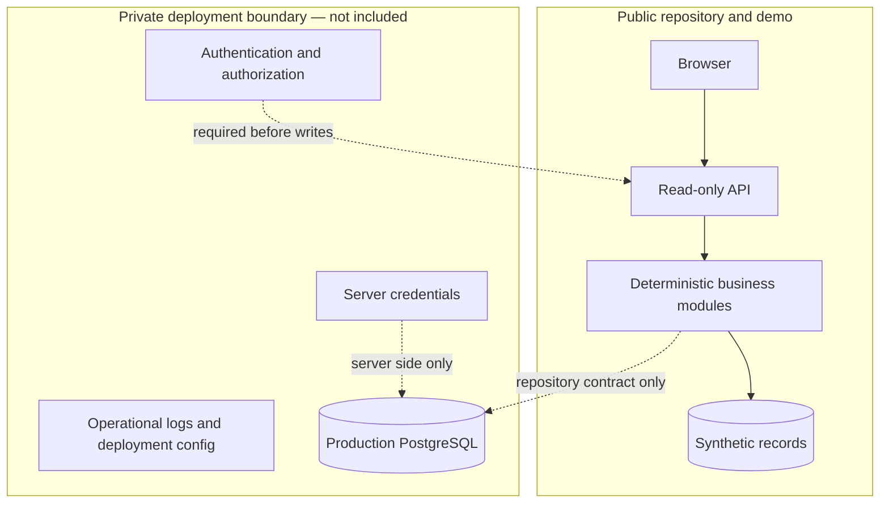

# Architecture

## Objective

The public edition demonstrates how a CRM question becomes a reproducible business result. It keeps data retrieval, business calculation, recommendation policy, presentation, and evaluation separate so that each layer can be tested or replaced without hiding the decision path.

## Runtime flow

## Components

### Domain layer

`src/domain` defines entities, request/result contracts, multilingual evidence, and strict input validation. It has no HTTP or storage dependency.

### Analytics layer

`src/analytics/metrics.ts` owns net revenue, average order value, frequency multiplier, recency, heuristic LTV, and churn-threshold calculations. Tool or UI code does not duplicate those formulas.

### Repository layer

`CrmRepository` is the read contract used by tools. `InMemoryCrmRepository` powers the public demo with generated records. `PostgresCrmRepository` demonstrates parameterized SQL against an injected client. It deliberately contains no driver initialization, URL, password, Supabase project identifier, or role key.

### Tool layer

Each tool has a stable name, semantic version, localized responsibility, typed input, typed output, evidence, and caveats. Tools calculate business facts; they do not render UI or hold deployment credentials.

### Orchestration layer

The orchestrator maps multilingual keywords to one of four supported intents and runs a visible tool sequence. The `decisionRationale` field is a concise business explanation generated from rules. It is not a hidden chain-of-thought transcript.

### API and UI

The API exposes three read-oriented routes and converts validation/not-found failures to explicit HTTP status codes. The UI renders only text through DOM `textContent`, uses same-origin calls, and ships with a restrictive Content Security Policy.

## Trust boundaries

There are no public create, update, delete, import, reset, messaging, or administrative operations. The schema enables row-level security without adding permissive public policies.

## Future private-agent seam

A future private LLM layer could translate a natural-language question into a validated intent and explain the returned tool result. It should call the same tools, never receive database credentials, never replace deterministic metric code, and never execute customer-facing actions without authorization. That layer is not implemented here.
