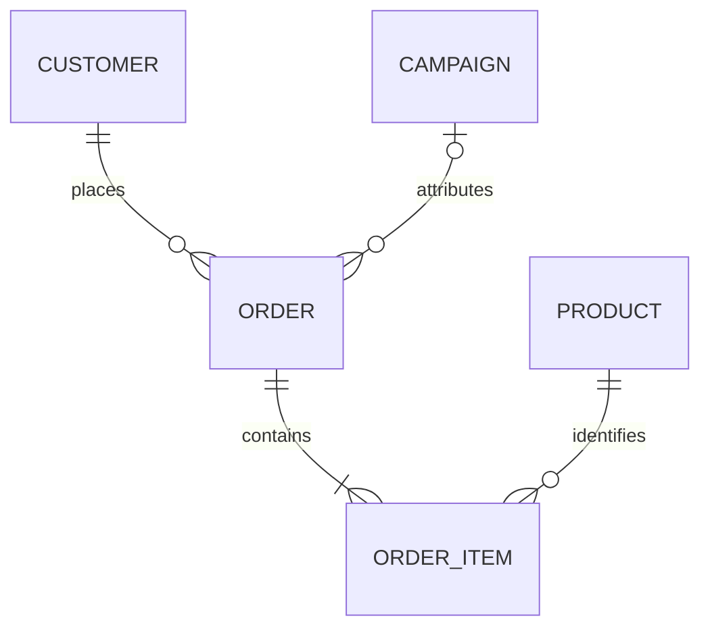

# Data model

## Modeling goals

The model is intentionally small: preserve the business semantics required for customer value, recency, product affinity, and campaign attribution while keeping entity grains and relationships unambiguous.

## Grains

| Entity | Grain | Identifier | Notes |
|---|---|---|---|
| `customers` | one row per fictional customer | `customer.id` | Public model omits email, address, phone, and free-form PII. |
| `products` | one row per fictional SKU | `product.id` | `role` supports interpretable cross-sell rules. |
| `orders` | one checkout event per customer | `order.id` | Holds date, channel, discount signal, and optional campaign attribution. |
| `order_items` | one product line per order | `order_item.id` | Quantity and observed unit price belong at line grain. |
| `campaigns` | one CRM campaign definition | `campaign.id` | Contains target segment, action, status, dates, and budget. |

## Entity relationships

- An order must reference an existing customer.
- An order item must reference an existing order and product.
- Deleting a customer with orders is restricted.
- Deleting an order cascades to its line items because those rows have no independent business meaning.
- Deleting a product referenced by history is restricted.
- Removing a campaign attribution sets `orders.campaign_id` to `NULL` instead of deleting the order.

## Integrity constraints

The sanitized migration enforces:

- non-empty names and categories;
- finite controlled values for segments, channels, product roles, status, and price sensitivity;
- positive quantity;
- non-negative price and budget;
- discount rate between 0 and 100;
- campaign end date on or after start date;
- one product line per order in the simplified public schema;
- indexes for customer history, campaign attribution, product affinity, and campaign filtering;
- row-level security enabled on every business table.

## Analytical derivations

Revenue is computed at order grain from its order-item rows and recorded discount. Customer metrics aggregate eligible orders up to an explicit `asOfDate`. This makes the result reproducible and prevents current wall-clock time from silently changing evaluation outputs.

The dataset uses `2026-09-30` as its fixed analysis date. All names, IDs, purchases, prices, segments, and campaigns are generated examples; they do not map to private records.

## Production boundary

The public model is not a complete production customer schema. Consent, identity resolution, deletion requests, source provenance, currency handling, refunds, tax, fulfillment, slowly changing attributes, and campaign exposure events would require additional modeling and governance in a private deployment.
