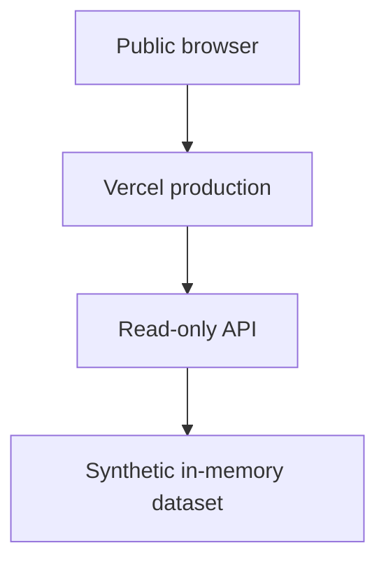

# Public demo deployment

[English](#english) · [日本語](#日本語) · [简体中文](#简体中文)

## Live demo

[Open the production demo](https://haruka-crm-intelligence-demo.vercel.app) — anonymous access, English / 日本語 / 简体中文, no account required.

Select **Try this example · CUST-002**, then run the analysis. The expected campaign is `personalized_win_back`, with observed revenue JPY 4,000 and heuristic LTV JPY 4,800. Evidence links to `ORD-200`, `ITEM-200`, and explicit rules. The page also shows four tool calls and limitations. Neither the initial page load nor selecting the example executes an analysis.

No production database or production customer data is connected to this deployment.

The dedicated project is linked only to this public repository's `main` branch. The live URL is the production alias, not a preview URL. GitHub provides implementation and evaluation evidence; the live demo provides interaction evidence.

## English

The deployment is synthetic-only and read-only. No environment variables, account, database, API credential, analytics integration, or external model is required. The public project has no configured environment variables. `DATA_MODE=synthetic` is the only optional runtime mode; other values fail closed. Do not configure a database connection. Automatic exposure of platform environment variables, deployment feedback, and OIDC token injection are disabled for this project.

1. Run `npm ci --ignore-scripts` and `npm run verify` from this repository.
2. Create a dedicated Vercel project from this repository, with framework preset **Other** and Node.js **22.x**. Do not reuse a production project or inherit its environment variables.
3. The checked-in `vercel.json` runs `npm run build:vercel`. This produces Vercel Build Output API v3 assets under `.vercel/output`.
4. Review the artifact: four static assets and one bounded, read-only API function. The PostgreSQL adapter, SQL files, source maps, tests, environment files, dependencies and Git metadata are not shipped to the runtime.
5. Verify the deployed home page, `/api/health`, the CUST-002 campaign workflow and all three languages. Initial page load and “Try this example” do not execute a decision.
6. Confirm write/import/reset/admin routes return 404. Keep the verified production URL in the README and repository website field, and check that the production deployment's Git commit matches the public `main` release.

### Public verification

- Anonymous HTTP requests to the homepage, all four static assets, and the read APIs succeed without cookies, credentials, or a login redirect.
- `GET /api/health` reports `synthetic`: 6 customers, 5 products, 11 orders, and 3 campaigns.
- CUST-002 produces the same recommendation, metrics, source IDs, and four-step tool trace in English, Japanese, and Simplified Chinese.
- Browser validation covers the initial empty state, explicit execution, localized evidence and limitations, and application console warnings/errors.
- Write/import/reset/admin requests, environment files, Git/deployment metadata files, and source maps return 404. Browser assets and API responses are checked for private identifiers and credential patterns.
- A same-origin Content Security Policy, `nosniff`, frame blocking, and no-referrer policy are served; API responses use `Cache-Control: no-store`.
- `npm run verify` checks source/history safety, typecheck, lint, tests, evaluation, build output, deployment handler behavior, and Markdown links. Run `npm audit` and `npm run links:check -- --external` as additional release gates.

The API accepts at most 8 KiB of valid UTF-8 JSON. It does not log or store submitted questions, use cookies, localStorage, or tracking. The hosting provider may still retain access metadata such as IP address and URL. Do not enter personal information in the demo. Platform rate limits and cost protection remain the deployer's responsibility; no application authentication or per-user quota is claimed.

The HTTP `POST /api/agent/run` computes a result; it does not mutate records or dispatch a campaign. The word `agent` in the route describes the deterministic tool interface, not LLM inference.

## 日本語

公開デモは合成データ専用・読み取り専用です。認証、DB、APIキー、外部モデルは不要です。専用VercelプロジェクトでNode.js 22.xと`vercel.json`を使用し、本番設定を流用しないでください。必要なら`DATA_MODE=synthetic`のみ設定します。

ビルド成果物からPostgreSQL adapter、SQL、source map、環境ファイルを除外します。[公開デモ](https://haruka-crm-intelligence-demo.vercel.app)は認証不要・環境変数未設定で、CUST-002の施策分析、三言語、禁止された書き込みルートの404を確認済みです。本番DB・本番顧客データは接続していません。質問はアプリに保存されませんが、ホスティング事業者がアクセスメタデータを保持する可能性があります。個人情報を入力しないでください。

## 简体中文

公开演示仅使用合成数据、只读运行，不需要认证、数据库、API 密钥或外部模型。使用独立的 Vercel 项目、Node.js 22.x 和仓库中的`vercel.json`，不要复用生产项目配置；如需设置模式，仅使用`DATA_MODE=synthetic`。

部署包排除 PostgreSQL adapter、SQL、source maps 和环境文件。[公开演示](https://haruka-crm-intelligence-demo.vercel.app)无需登录，没有配置环境变量；已验证 CUST-002 的决策流程、三语切换和写入路径的 404。此部署没有连接生产数据库或生产客户数据。应用不保存问题，但托管平台可能保留访问元数据；不要输入个人资料。平台限流及费用保护仍由部署者负责。
